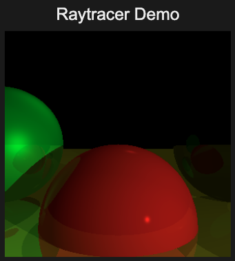
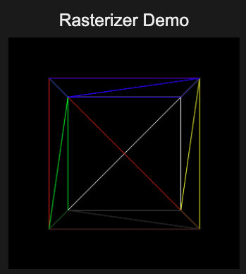

# Graphic renders in js

A personal deep dive into the foundations of computer graphics

## About the Project

The goal of this project was to deeply understand the fundamentals of rendering by building everything manually — without relying on any graphics engines or abstraction layers.

The only external tool used was a math library for vector operations. Everything else, including the rendering pipelines, lighting, camera logic, texture sampling, and scene handling, was implemented from scratch.

## What I Built

### Ray Tracer

A physically-inspired rendering system that simulates light paths to produce realistic images. It handles:

- Ray-object intersections
- Basic lighting models
- Reflection and shading logic
- Camera ray generation

### Rasterizer

A software rendering pipeline that converts 3D geometry into pixels, written in plain JavaScript and drawn to a 2D canvas one pixel at a time. It covers the full path from model space to the screen:

**Geometry and transforms**

- Procedurally generated meshes: cube, UV sphere and cylinder (with caps)
- Shape instances with per-object scale, rotation (X/Y/Z) and translation
- Bounding spheres for each shape

**Camera and visibility**

- Perspective projection onto a viewport
- Frustum culling of whole objects using their bounding spheres
- Triangle clipping against the near, left, right, top and bottom planes, with all vertex attributes (position, normals, UVs, intensity) interpolated at the cut
- Back-face culling
- Per-pixel depth buffer using `1/z`

**Rasterization**

- Wireframe mode (line drawing) and filled mode
- Scanline triangle filling with edge interpolation
- Barycentric coordinate rasterization for per-pixel shading
- Perspective-correct interpolation of UVs and normals

**Lighting and shading**

- Directional light with ambient + Lambert diffuse term
- Flat shading (one intensity per triangle)
- Gouraud shading (intensity computed per vertex and interpolated)
- Phong shading (normals interpolated and lit per pixel)
- Smooth vertex normals computed by averaging adjacent face normals

**Materials and textures**

- Material system with flat colors, textures, shading mode and normal maps
- Texture loading from images into raw pixel data
- Mipmap generation (box filter down to 1×1)
- Bilinear filtering within a mip level and trilinear filtering between levels
- Automatic mip level selection from screen-space UV gradients
- Normal mapping using a per-triangle tangent basis, re-orthogonalised against the interpolated normal, with handedness handling

**Interface**

- Dropdowns to switch between render modes (wireframe / filled) and shading modes (flat / Gouraud / Phong) and re-render the scene

## Demo

You can try the live version of the project here:

**[Live Demo](https://pavelharoshka.github.io/graphic-render/)**

## Results

Below are some example outputs generated by the ray tracer and rasterizer.

